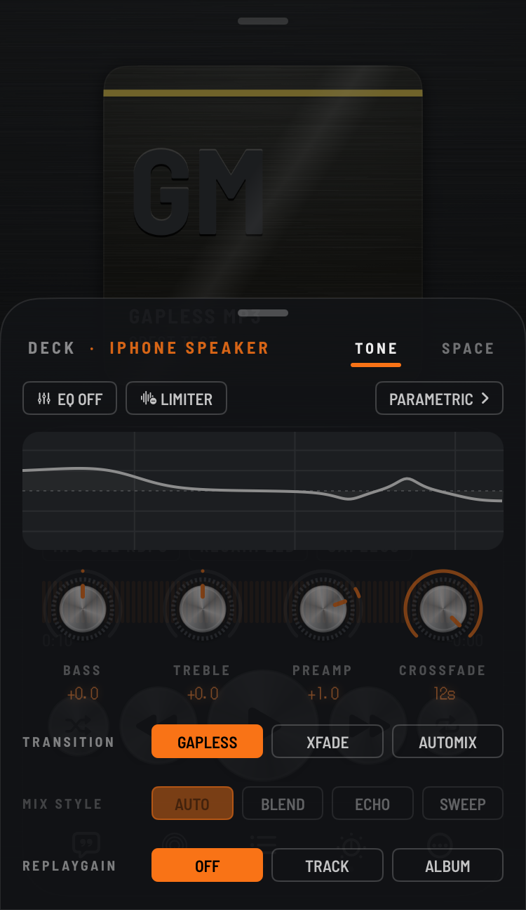
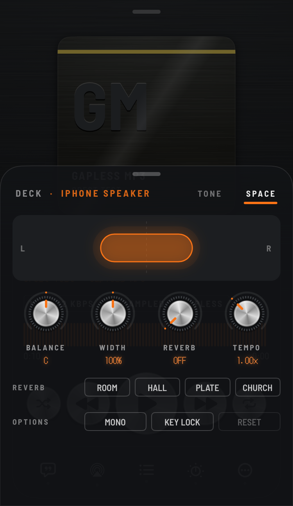
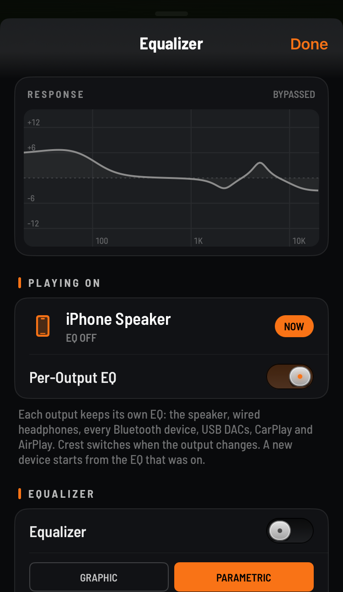

# Crest

A high-quality offline music player for iPhone. Every song plays at its own sample rate, it plays nearly every
format you can throw at it, and it looks like a piece of hi-fi gear, not an Apple Music clone.

Crest plays **your own files**: no streaming, no account, no tracking.

**Status: public beta (1.0.0 Beta 2).** This repo holds the releases and the issue tracker;
Crest's own source code is not published.

## Install

Pick the one that matches your phone. Downloads are on the [Releases](../../releases) page.

| Your phone | Get | Notes |
|---|---|---|
| Jailbroken, rootless (Dopamine, palera1n…) | the **.deb**, or add the repo `https://jond-ie.github.io/repo` in Sileo / Zebra | Full features. The repo gives you updates. |
| TrollStore | **Crest_…\.tipa** | Full features, same as the jailbreak build. |
| Not jailbroken | **Crest_…-sideload.ipa** with AltStore, SideStore, Sideloadly or similar | Sandboxed, see below. |

- **iOS 15 and up.** One build runs on every iPhone that can run iOS 15.
- Don't install the .tipa on a phone that already has the jailbreak .deb: they use the same app ID. Pick one.

> **Adding music on the sideload build (and possibly the TrollStore build): use Wi-Fi Transfer for now.**
> Importing through the Files app may not work on those builds yet. Wi-Fi Transfer is tested and works.

### What the sideload version can't do
Sideloaded apps run in Apple's sandbox, so:
- It only sees music you put **into Crest**, and for now that means **Wi-Fi Transfer** (drag songs in from a
  computer's browser). It can't see songs synced to the Music app.
- No CarPlay (that needs an entitlement sideloading can't grant).
- The widget only works if your signing tool keeps the app group.
- With a free Apple ID, the app has to be re-signed every 7 days (your sideloading tool does this).

## What it does

### Playback
- Plays **FLAC, ALAC, WAV, AIFF, MP3, AAC, Opus, Vorbis, APE, WavPack, Musepack, TAK, TTA, WMA, DSD** (DSF/DFF)
  and **CUE sheets**.
- **Bit-perfect where the hardware allows:** each song plays at its own sample rate; Crest only resamples when the
  output can't do the file's rate, and shows it (the RESAMPLED tag on the player).
- **Gapless** playback, **crossfade**, and **Automix**: beat-matched transitions with tempo matching, plus echo-out
  and filter-sweep styles. Albums stay gapless even with Automix on.
- **ReplayGain** (track / album) and EBU R128 loudness levelling.
- Plays the songs already synced to the **Music app** too (jailbreak / TrollStore builds; not Apple Music
  downloads or anything with DRM).
- The queue comes back after a relaunch, paused where you left it.

### Sound
- **16-band parametric EQ** (or a graphic one), **AutoEQ** headphone profile import, and a separate EQ per output:
  speaker, AirPods, a USB DAC… each keeps its own and Crest switches when you connect.
- **The Deck** (swipe up on the player): a **Tone** page with the EQ curve, bass / treble / preamp / crossfade knobs,
  the limiter, transitions and ReplayGain, and a **Space** page with balance, stereo width, reverb (room, hall,
  plate, church), tempo, mono and key lock.

### Library
- Albums, artists, genres, folders, songs; search; **smart playlists** with rules; ratings; listening history and
  stats.
- **Synced lyrics** (word by word where the file has it), a tag editor, and file info (format, bit depth, sample
  rate, bitrate).
- Add music with **Wi-Fi Transfer** from any computer on the same network, or from the **Files** app (jailbreak
  build; see the note above for TrollStore / sideload).

### Everything else
- **Scrobbling** to ListenBrainz and Last.fm (optional; off until you connect an account).
- A **Now Playing widget**, **CarPlay** (jailbreak / TrollStore builds) and lock screen / Control Center controls.
- A sleep timer (including "stop after this song"), a visualizer and a stereo field view.

## Themes and the look
Crest is meant to feel like a piece of hi-fi gear you'd want on a shelf, not another flat list of songs.

- **"Smoked Acrylic Hi-Fi"**: smoked glass panels over a near-black brushed base, spun-aluminium round keys,
  square-cut chips, and a dot-matrix display for the song title (in a bundled pixel font).
- **7 accent colours**: Mint, Amber, Ice, Rose, Violet, Lime and Orange. The accent runs through the buttons, the
  waveform, the knob rings, the glows and even the dot-matrix ink.
- **Two bases**: Graphite, or **OLED Black** for a fully black background.
- **Album pages take their colours from the cover art** (the way iTunes 11 did): the title, buttons and track list
  pick up the album's own palette.
- **Songs without artwork get a generated cover**: an anodised metal plate with the album's initials and a colour
  stripe, so the library never looks empty.
- **Optional L/R VU meters** under the waveform (Settings → Appearance; off by default, and they cost nothing when off).
- Knobs that turn with a drag and a detent, latching shuffle / repeat keys, and haptics on the controls.

## How Automix works
Automix is a DJ-style transition engine, not a plain crossfade:
- It reads each song's tempo and beat grid and starts the blend **exactly on a beat**, so the two songs stay locked.
- **Tempo matching**: the incoming song is stretched to the outgoing tempo during the blend (e.g. 120 → 124 BPM),
  then glides back to its own tempo over its next 8 beats and plays untouched from there.
- **Bass swap**: the incoming song comes in without its bass; halfway through, on a beat, the basslines swap, so
  two basslines never fight each other.
- **Echo out**: the last beat of the outgoing song repeats and fades (each repeat a little quieter and darker)
  while the next song starts on the cut.
- **Filter sweep**: the outgoing song is filtered away as the new one comes in.
- Loudness is matched across the transition, and **albums stay gapless** even with Automix on.

## Under the hood
- **Decoding**: Apple's own decoders where they handle the file, and a decode-only FFmpeg build (as its own
  library) for everything else, all feeding one playback engine.
- **Sample rates**: the audio session is switched to each file's own rate, so a 44.1 kHz song and a 96 kHz song
  both play natively when the output supports it. Crest marks the songs it has to resample.
- **EQ and effects**: a parametric EQ with per-output presets, a limiter, ReplayGain that never
  pushes a song past full scale, and a time-stretcher (Signalsmith Stretch) for tempo and key lock.
- **Library**: an on-device database with smart-playlist rules, play counts, ratings and history; tags are read and
  written with TagLib.
- **Interface**: SwiftUI for the screens, with the parts that redraw every frame (waveform, meters, visualizer, EQ
  curve) kept on Core Animation so scrolling and the player stay smooth, even on an A13.
- About 20,000 lines of Objective-C and Swift, plus the open-source parts listed below.

## Tested on
- Jailbroken: iOS 16.2 (A13) and iOS 17.5.1 (A13), rootless.
- TrollStore: installs and runs.
- Sideloaded: a stock iPhone on **iOS 27 beta** (installs, plays, Wi-Fi Transfer works).
- Not tested yet: CarPlay in a real car, iOS 15 with this beta, and many weird files. Reports welcome.

## Known issues (Beta 2)
- Sideload build, and possibly the TrollStore build: only **Wi-Fi Transfer** is supported for adding music right
  now; importing through the Files app may not work yet.
- CarPlay hasn't been tried in a car.

## Bugs and ideas
Open an [issue](../../issues): say which build (.deb / .tipa / sideload), your iOS version, and what happened. For
files that won't play or sound wrong, say the format (Crest shows it under Get Info).

## Privacy
Crest has no analytics and no ads. It only talks to the internet if you turn on scrobbling (ListenBrainz /
Last.fm) or online lyrics (LRCLIB); both are off until you switch them on. Wi-Fi Transfer only runs while its
screen is open, and asks for a PIN shown on the phone.

## Open-source parts
Crest uses FFmpeg (LGPL 2.1, as a separate dynamic library), TagLib (MPL 1.1), Opus and Ogg (BSD), utfcpp (Boost)
and Signalsmith Stretch (MIT). Full license texts are in the app (Settings → Open-Source Licenses).
[`third-party/`](third-party) has the exact FFmpeg build script and the one change made to TagLib, so you can
rebuild or replace those parts.

Crest itself is © John d_ie, all rights reserved.
