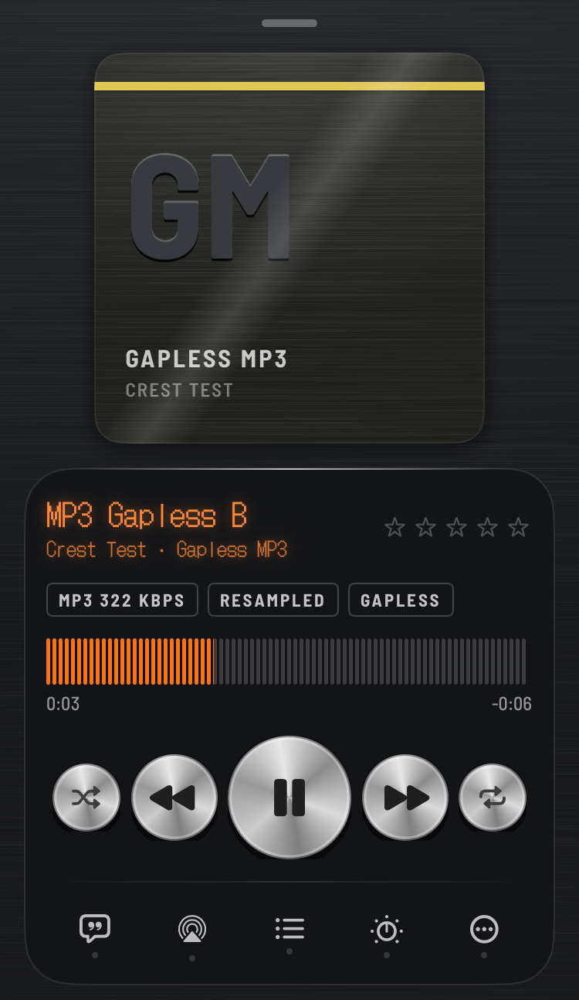
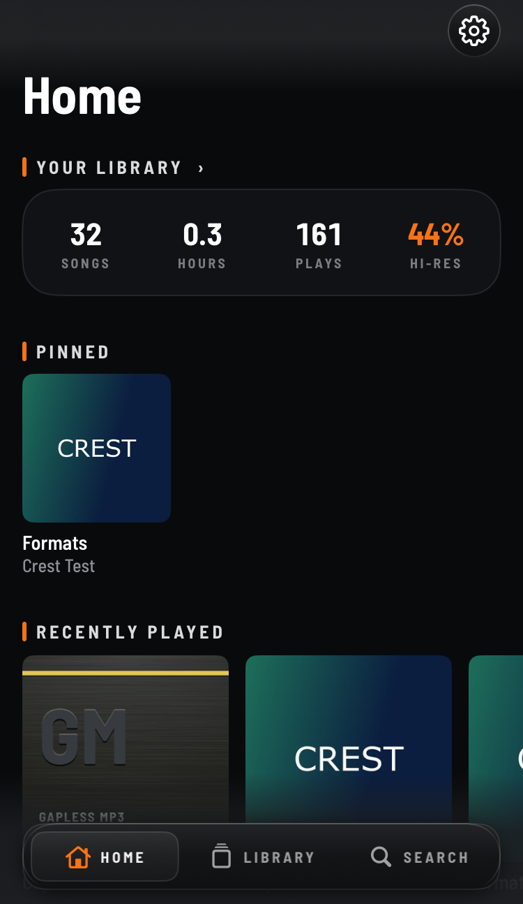
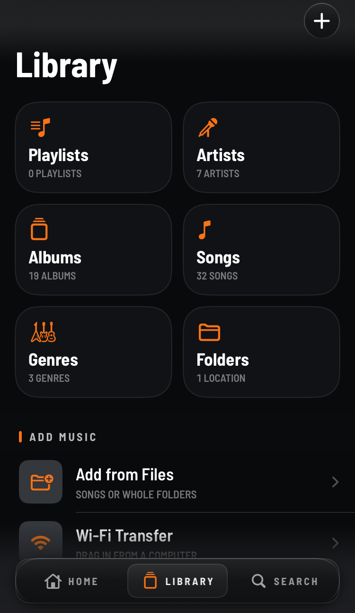
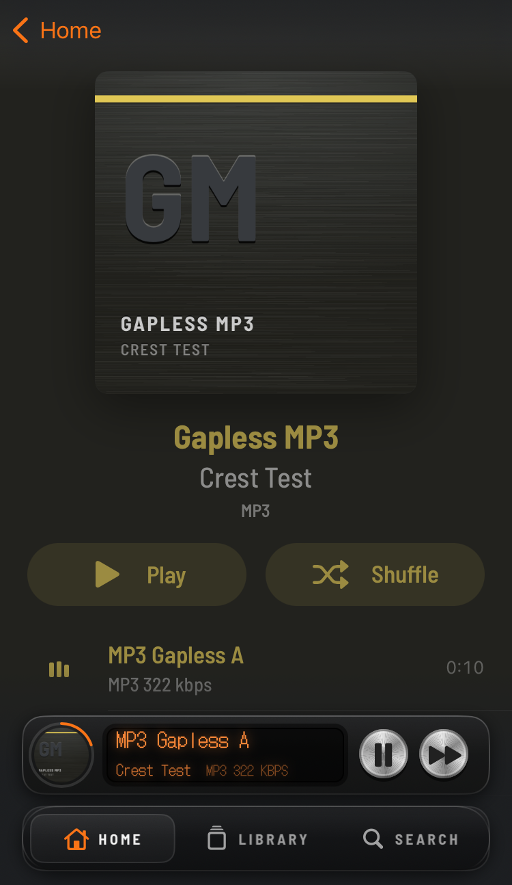

# Crest

A high-quality offline music player for iPhone. Every song plays at its own sample rate, it plays nearly every
format you can throw at it, and it looks like a piece of hi-fi gear, not an Apple Music clone.

Crest plays **your own files**: no streaming, no account, no tracking.

**Status: public beta (1.0.0 Beta 2).** Free during the beta. This repo holds the releases and the issue tracker;
Crest's own source code is not published.

## Install

Pick the one that matches your phone. Downloads are on the [Releases](../../releases) page.

| Your phone | Get | Notes |
|---|---|---|
| Jailbroken, rootless (Dopamine, palera1n…) | the **.deb**, or add the repo `https://jond-ie.github.io/repo` in Sileo / Zebra | Full features. The repo gives you updates. |
| TrollStore | **Crest_…\.tipa** | Full features, same as the jailbreak build. |
| Not jailbroken | **Crest_…-sideload.ipa** with AltStore, SideStore, Sideloadly or similar | Sandboxed, see below. |

- **iOS 15 and up.** One build runs on every iPhone that can run iOS 15.
- Don't install the .tipa on a phone that already has the jailbreak .deb: they use the same app ID. Pick one.

> **Adding music on the sideload build (and possibly the TrollStore build): use Wi-Fi Transfer for now.**
> Importing through the Files app may not work on those builds yet. Wi-Fi Transfer is tested and works.

### What the sideload version can't do
Sideloaded apps run in Apple's sandbox, so:
- It only sees music you put **into Crest**, and for now that means **Wi-Fi Transfer** (drag songs in from a
  computer's browser). It can't see songs synced to the Music app.
- No CarPlay (that needs an entitlement sideloading can't grant).
- The widget only works if your signing tool keeps the app group.
- With a free Apple ID, the app has to be re-signed every 7 days (your sideloading tool does this).

## What it does

### Playback
- Plays **FLAC, ALAC, WAV, AIFF, MP3, AAC, Opus, Vorbis, APE, WavPack, Musepack, TAK, TTA, WMA, DSD** (DSF/DFF)
  and **CUE sheets**.
- **Bit-perfect where the hardware allows:** each song plays at its own sample rate; Crest only resamples when the
  output can't do the file's rate, and shows it (the RESAMPLED tag on the player).
- **Gapless** playback, **crossfade**, and **Automix**: beat-matched transitions with tempo matching, plus echo-out
  and filter-sweep styles. Albums stay gapless even with Automix on.
- **ReplayGain** (track / album) and EBU R128 loudness levelling.
- Plays the songs already synced to the **Music app** too (jailbreak / TrollStore builds; not Apple Music
  downloads or anything with DRM).
- The queue comes back after a relaunch, paused where you left it.

### Sound
- **16-band parametric EQ** (or a graphic one), **AutoEQ** headphone profile import, and a separate EQ per output:
  speaker, AirPods, a USB DAC… each keeps its own and Crest switches when you connect.
- Bass / treble / preamp knobs, a limiter, balance, stereo width, mono, reverb, tempo and key lock.

### Library
- Albums, artists, genres, folders, songs; search; **smart playlists** with rules; ratings; listening history and
  stats.
- **Synced lyrics** (word by word where the file has it), a tag editor, and file info (format, bit depth, sample
  rate, bitrate).
- Add music with **Wi-Fi Transfer** from any computer on the same network, or from the **Files** app (jailbreak
  build; see the note above for TrollStore / sideload).

### Everything else
- **Scrobbling** to ListenBrainz and Last.fm (optional; off until you connect an account).
- A **Now Playing widget**, **CarPlay** (jailbreak / TrollStore builds) and lock screen / Control Center controls.
- The **"Smoked Acrylic Hi-Fi"** look: smoked glass panels, spun-aluminium keys, a dot-matrix display that follows
  your accent colour, optional L/R VU meters.

## Tested on
- Jailbroken: iOS 16.2 (A13) and iOS 17.5.1 (A13), rootless.
- TrollStore: installs and runs.
- Sideloaded: a stock iPhone on **iOS 27 beta** (installs, plays, Wi-Fi Transfer works).
- Not tested yet: CarPlay in a real car, iOS 15 with this beta, and many weird files. Reports welcome.

## Known issues (Beta 2)
- Sideload build, and possibly the TrollStore build: only **Wi-Fi Transfer** is supported for adding music right
  now; importing through the Files app may not work yet.
- CarPlay hasn't been tried in a car.

## Bugs and ideas
Open an [issue](../../issues): say which build (.deb / .tipa / sideload), your iOS version, and what happened. For
files that won't play or sound wrong, say the format (Crest shows it under Get Info).

## Privacy
Crest has no analytics and no ads. It only talks to the internet if you turn on scrobbling (ListenBrainz /
Last.fm) or online lyrics (LRCLIB); both are off until you switch them on. Wi-Fi Transfer only runs while its
screen is open, and asks for a PIN shown on the phone.

## Open-source parts
Crest uses FFmpeg (LGPL 2.1, as a separate dynamic library), TagLib (MPL 1.1), Opus and Ogg (BSD), utfcpp (Boost)
and Signalsmith Stretch (MIT). Full license texts are in the app (Settings → Open-Source Licenses).
[`third-party/`](third-party) has the exact FFmpeg build script and the one change made to TagLib, so you can
rebuild or replace those parts.

Crest itself is © John d_ie, all rights reserved.
